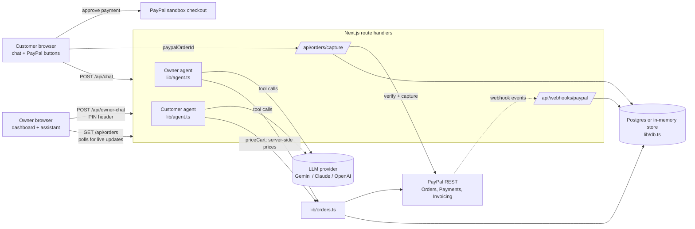

# ChatCart AI

**An AI sales agent for chat-based small sellers: customers order in plain language, pay with PayPal inside the chat, and the owner runs the shop (orders, invoices, refunds) by talking to an assistant.**

Built for the PayPal AI Hackathon on Devpost.

- Live demo: https://chatcart-ai-alpha.vercel.app
- Demo video: `<DEMO_VIDEO_URL — to be added>`
- Licence: [MIT](LICENSE)

> All payments use the **PayPal sandbox**. No real money moves.

---

## The problem

Millions of home bakers, tailors and snack makers sell through WhatsApp or Instagram chats. Every order is a manual conversation: answer "what do you have?", write the price by hand, check the total, share bank details, wait for a screenshot, then track it all in a notebook. Mistakes in prices and totals are common, payments are hard to verify, and refunds are awkward.

**Who it is for:** solo sellers and tiny shops that already sell in chat and have no web developer, no inventory system and no time.

## What it does

### Customer flow (`/`, or `/s/<shop>`)

1. The customer chats in plain language ("2 chocolate cakes and a box of cupcakes for Saturday, no nuts").
2. The AI agent matches the request to the shop menu and asks follow-up questions (name, notes, pickup date).
3. The agent shows a cart summary and asks the customer to confirm.
4. Only after an explicit "yes", the server creates a PayPal order. The total is computed on the server from the menu.
5. PayPal buttons appear in the chat. The customer pays. The server verifies and captures the payment and the order becomes `PAID`.
6. The customer can ask "where is my order CC-1234?" and get the payment and pickup-ready status.
7. For something not on the menu (for example a custom cake), the agent never invents a price. It records a custom quote request for the owner.

### Owner flow (`/dashboard`)

1. Unlock the dashboard with a 6-digit owner PIN.
2. See live orders and stats (paid, pending, refunded, invoiced, revenue).
3. Ask the owner assistant in plain language: "What's pending today?", "How much did I make?", "Mark CC-1234 as ready".
4. Refund an order by chat. The assistant states the order, customer and amount and asks for confirmation. Only after the owner confirms does it issue a real PayPal sandbox refund.
5. Turn a custom quote request into a PayPal invoice by chat. The owner chooses the price and confirms the details before the invoice is sent.

### Create your own shop (`/new`)

A seller can paste a messy price list (any format). The AI extracts structured menu items, the server validates them (price limits, de-duplication, length limits), and a new shop is created with its own storefront link (`/s/<slug>`), dashboard (`/dashboard/<slug>`) and a random PIN shown once.

## How PayPal is used

All PayPal calls are plain REST calls in [`lib/paypal.ts`](lib/paypal.ts). Business logic around them is in [`lib/orders.ts`](lib/orders.ts) and the routes under [`app/api`](app/api).

| PayPal API | What for | Where |
| --- | --- | --- |
| OAuth 2.0 client credentials (`POST /v1/oauth2/token`) | Server-side access token, cached until near expiry | `getAccessToken` in `lib/paypal.ts` |
| Orders v2 create (`POST /v2/checkout/orders`) | Intent `CAPTURE`, itemised `purchase_units` with `item_total` breakdown, our order id in `custom_id`, `PayPal-Request-Id` for idempotency | `createOrder`, called from `placeOrder` in `lib/orders.ts` |
| Orders v2 get (`GET /v2/checkout/orders/{id}`) | Before capturing, check that PayPal's `custom_id`, currency and amount match our stored order | `getOrder`, used in `app/api/orders/capture/route.ts` |
| Orders v2 capture (`POST /v2/checkout/orders/{id}/capture`) | Take the payment after the buyer approves in the PayPal buttons; the order becomes `PAID`. Idempotent | `captureOrder`, `app/api/orders/capture/route.ts` |
| Payments v2 refund (`POST /v2/payments/captures/{id}/refund`) | Refund a paid order after the owner confirms in chat | `refundCapture`, called from `refundOrderByCode` in `lib/orders.ts` |
| Invoicing v2 (`POST /v2/invoicing/invoices`, then `/send`, then `GET`) | Custom, owner-priced orders are sent to the customer as a PayPal invoice | `createAndSendInvoice`, called from `createCustomInvoice` in `lib/orders.ts` |
| Webhooks (`POST /v1/notifications/verify-webhook-signature`) | Optional. Verified events `PAYMENT.CAPTURE.COMPLETED`, `PAYMENT.CAPTURE.REFUNDED`, `INVOICING.INVOICE.PAID` keep order status in sync, including invoices paid outside the app | `verifyWebhookSignature`, `app/api/webhooks/paypal/route.ts` |
| PayPal JS SDK buttons (`@paypal/react-paypal-js`) | The customer pays inside the chat | `components/Storefront.tsx` (+ `components/ChatPanel.tsx`) |

## How AI is used

The AI is a tool-calling agent, not a text generator. It runs in [`lib/agent.ts`](lib/agent.ts) with the Vercel AI SDK (`generateText` with a multi-step tool loop, at most 6 steps per turn). The model provider is auto-detected from your env vars (Google Gemini, Anthropic Claude or OpenAI; see [`lib/ai.ts`](lib/ai.ts)).

**Customer agent tools:** `get_menu`, `create_order`, `get_order_status`, `request_custom_quote`.

**Owner agent tools:** `list_orders`, `sales_summary`, `list_quote_requests`, `mark_ready`, `refund_order`, `create_custom_invoice`.

**Shop onboarding:** `app/api/shops/import/route.ts` uses structured output to turn a pasted price list into menu items. The result is treated as untrusted and cleaned by `lib/menu-import.ts`.

### Safety rules (enforced in code, not only in the prompt)

- **Server-side pricing.** The model never supplies a price. `create_order` takes item ids and quantities only. `priceCart` in `lib/menu.ts` computes every line and total from the shop menu, using integer cents, and rejects unknown items or bad quantities. Custom items get no AI price at all: the owner sets it.
- **Confirm before charge.** `create_order` requires `customerConfirmed: true`, which the prompt allows only after the customer says yes to the cart summary in their latest message. Nothing is charged by the agent anyway: it only creates a PayPal order. The customer still has to approve and pay in the PayPal buttons, and the server checks PayPal's order against ours before capture.
- **Confirm before refund.** `refund_order` and `create_custom_invoice` require `confirmed: true`. The server also refuses if there is no earlier assistant message in the conversation, so a confirmation cannot happen in the same turn as the first request. Only `PAID` orders with a capture can be refunded.
- **Owner access.** Owner endpoints require the owner PIN (`x-owner-pin` header), with a failed-attempt limiter. The demo shop PIN comes from `OWNER_PIN`; other shops store only a salted scrypt hash.
- **No secrets in responses.** Errors are plain-English `{ "error": "..." }` messages.

## Architecture



## Tech stack

- Next.js 16 (App Router, route handlers), React 19, TypeScript, Tailwind CSS 4
- Vercel AI SDK (`ai` v7) with `@ai-sdk/google`, `@ai-sdk/groq`, `@ai-sdk/anthropic`, `@ai-sdk/openai` (the live demo runs on Groq)
- Zod 4 for tool and request schemas
- PayPal REST APIs (sandbox) and `@paypal/react-paypal-js`
- Postgres via `pg` (the live demo uses Neon Postgres); in-memory store when no database is configured
- Deployed on Vercel

## Quick start

Requirements: Node.js 20 or newer, npm.

```bash
git clone https://github.com/Professional-Web-Developer/chatcart-ai.git
cd chatcart-ai
npm install
cp .env.example .env.local
# edit .env.local: add PayPal sandbox credentials and one AI key (see below)
npm run dev
```

Open <http://localhost:3000>.

The app builds and starts with **no environment variables at all**. It shows a setup notice until PayPal and an AI key are configured.

For a production build: `npm run build && npm start`.

### 1. Get PayPal sandbox credentials

1. Go to <https://developer.paypal.com> and log in (a normal PayPal account works; you do not need a business account).
2. Open **Apps & Credentials** in the dashboard and switch the toggle to **Sandbox**.
3. Click **Create App**, name it (for example `chatcart-ai`), choose type **Merchant**, and create it. (A default sandbox app may already exist; you can use it.)
4. Copy the **Client ID** and **Secret** from the app page.
5. Put them in `.env.local`:

```env
PAYPAL_CLIENT_ID=<client id>
NEXT_PUBLIC_PAYPAL_CLIENT_ID=<the same client id>
PAYPAL_CLIENT_SECRET=<secret>
PAYPAL_API_BASE=https://api-m.sandbox.paypal.com
```

### 2. Get a sandbox buyer (test) account

In the developer dashboard open **Testing Tools > Sandbox Accounts**. PayPal usually creates a **Personal** (buyer) and a **Business** (seller) sandbox account for you. If there is no Personal account, click **Create account** and choose type **Personal**. To see the buyer's email and password, open the account's menu (the three dots) and choose **View/Edit account**. Use these credentials in the PayPal login window when paying. Never use your real PayPal login in the sandbox flow.

Menu names in the PayPal dashboard can change over time; if you do not see these exact labels, look for "Sandbox accounts" under testing tools.

### 3. Add one AI key

Set **one** of these in `.env.local` (detected in this order):

| Provider | Variable | Default model |
| --- | --- | --- |
| Google Gemini | `GOOGLE_GENERATIVE_AI_API_KEY` | `gemini-flash-latest` |
| Groq (free tier) | `GROQ_API_KEY` | `openai/gpt-oss-120b` |
| Anthropic Claude | `ANTHROPIC_API_KEY` | `claude-haiku-5-5` |
| OpenAI | `OPENAI_API_KEY` | `gpt-5.4-mini` |

Optionally set `AI_MODEL` to use another model id from the same provider.

Restart `npm run dev` after editing `.env.local`. Check <http://localhost:3000/api/health>: you should see `"paypal": true` and `"ai": true`.

## Test it in 2 minutes (for judges)

If you are using the hosted demo, skip straight to step 2. The PayPal buyer login is below in step 3; for the hosted demo, use any sandbox Personal account (see "Get a sandbox buyer account").

1. **Run it** (local) or open the live demo link above. The header should show no setup warning.
2. **Order by chat.** In the customer chat, type: `Hi! I'm Priya. I'd like a chocolate truffle cake and a box of 6 cupcakes for Saturday, no nuts.`
3. **Confirm.** The agent summarises the cart with a server-computed total and asks you to confirm. Reply `Yes, please confirm`.
4. **Pay.** An order code like `CC-1234` and a PayPal button appear. Click it and log in with your **sandbox Personal (buyer) account**, then approve the payment.
5. **See it turn PAID.** The chat confirms the payment. Open `/dashboard`, enter the demo PIN `246810` (this is the default `OWNER_PIN`), and the order shows as `PAID` with updated stats.
6. **Ask the owner assistant.** In the dashboard chat: `What's pending today?` or `How much did I make?`.
7. **Refund by chat.** Type `Refund order CC-1234` (use your code). The assistant asks you to confirm the amount. Reply `Yes, refund it`. The order becomes `REFUNDED`, and you can see the refund in the sandbox buyer's PayPal activity.
8. **Optional.** Try `/new` to create your own shop from a pasted price list, or ask for a custom cake in the customer chat and then ask the owner assistant to invoice it (an invoice needs a customer email).

## Deployment

The app is a standard Next.js project and deploys to Vercel or any Node host.

- Set the environment variables from the table below in your host's settings.
- **Set `DATABASE_URL` on serverless hosts** (for example a free Neon Postgres database). Without it the app uses an in-memory store that resets on restart and is not shared between serverless instances, so orders can appear to disappear. The table is created automatically on first use.
- Keep `PAYPAL_API_BASE` at the sandbox URL unless you have completed PayPal's live-account review and really want live payments.
- Optional webhooks: in the PayPal developer dashboard, register `https://<your-domain>/api/webhooks/paypal` for `PAYMENT.CAPTURE.COMPLETED`, `PAYMENT.CAPTURE.REFUNDED` and `INVOICING.INVOICE.PAID`, then set `PAYPAL_WEBHOOK_ID`. Without it the endpoint answers 503 and the main payment flow still works, because capture happens through `/api/orders/capture`. Invoices paid outside the app are only marked `PAID` when the webhook is configured.

## Environment variables

| Variable | Required | Purpose |
| --- | --- | --- |
| `PAYPAL_CLIENT_ID` | for payments | PayPal sandbox REST app client id (server) |
| `PAYPAL_CLIENT_SECRET` | for payments | PayPal sandbox REST app secret (server only, never sent to the browser) |
| `NEXT_PUBLIC_PAYPAL_CLIENT_ID` | for payments | Same client id, used by the PayPal buttons in the browser |
| `PAYPAL_API_BASE` | no | Defaults to `https://api-m.sandbox.paypal.com` |
| `GOOGLE_GENERATIVE_AI_API_KEY` / `GROQ_API_KEY` / `ANTHROPIC_API_KEY` / `OPENAI_API_KEY` | one of them, for AI | AI provider key, detected in this order |
| `AI_MODEL` | no | Override the default model id |
| `DATABASE_URL` | no | Postgres connection string. If empty, in-memory store |
| `OWNER_PIN` | no | 6-digit PIN for the built-in demo shop. Defaults to `246810` |
| `PAYPAL_WEBHOOK_ID` | no | Enables `/api/webhooks/paypal` |

`NEXT_PUBLIC_*` values are embedded at build time, so rebuild after changing `NEXT_PUBLIC_PAYPAL_CLIENT_ID`.

## HTTP API

| Route | Purpose |
| --- | --- |
| `GET /api/health` | Which pieces are configured: `{ paypal, ai, aiProvider, db }` |
| `GET /api/menu?shop=<slug>` | Shop name, tagline and menu |
| `POST /api/chat` | Customer agent: `{ messages, shop? }` returns `{ reply, order? }` |
| `POST /api/orders/capture` | Verify and capture a PayPal order: `{ paypalOrderId }` |
| `GET /api/orders?shop=<slug>` | Owner only (PIN header): orders and stats |
| `POST /api/owner-chat` | Owner agent (PIN header): `{ messages, shop? }` returns `{ reply, changed }` |
| `POST /api/owner/verify` | Check an owner PIN |
| `GET /api/quotes?shop=<slug>` | Owner only: custom quote requests |
| `GET /api/shops/<slug>` | Public shop info |
| `POST /api/shops/import` | Create a shop from a pasted price list (rate limited) |
| `POST /api/webhooks/paypal` | PayPal webhook receiver (signature verified) |

## Project structure

```
app/
  page.tsx, s/[slug]/        customer storefront and chat
  dashboard/, dashboard/[slug]/   owner dashboard
  new/                       create a shop from a pasted price list
  api/                       route handlers (see HTTP API)
components/                  chat panel, storefront, dashboard, PIN gate, etc.
lib/
  agent.ts                   customer and owner AI agents and their tools
  ai.ts                      provider auto-detection
  paypal.ts                  PayPal REST client (orders, capture, refund, invoicing, webhook verify)
  orders.ts                  order, refund, ready and invoice logic
  menu.ts, menu-import.ts    default menu, server-side pricing, menu clean-up
  db.ts                      Postgres or in-memory store
  auth.ts, http.ts           owner PIN, rate limits, shared API helpers
docs/                        Devpost text and demo video script
```

## Limitations and roadmap

Honest limits of this hackathon build:

- **Sandbox only.** Going live requires a PayPal live app and review, and a business decision about fees and policies.
- **Demo-grade owner login.** A 6-digit PIN with attempt limiting, not full accounts.
- **Order state is stored per deployment.** With no `DATABASE_URL` it is in memory and resets on restart.
- **One currency (USD)** and no shipping or tax handling. Orders are pickup-style.
- **No chat-app integration yet.** The chat lives in the web app; there is no WhatsApp or Instagram connector.
- **No automated test suite** is included yet.
- **Partial refunds** are not supported; refunds are full.
- LLM answers can vary. Prices and totals do not, because they come from the server.

Ideas for next steps: WhatsApp and Instagram channels, real owner accounts, inventory and capacity limits, partial refunds, multiple currencies, delivery options, and automated tests for the agent safety rules.

## Licence

[MIT](LICENSE) © 2026 Kavin Pasupathy
