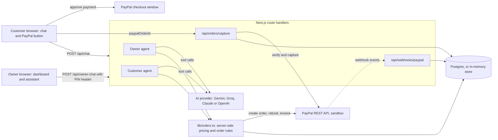

# ChatCart AI

**An AI sales agent for small sellers who chat with customers abroad: customers order in plain language and pay with PayPal inside the chat, and the owner runs the shop (orders, invoices, refunds) by talking to an assistant.**

Built for the PayPal AI Hackathon on Devpost.

- Live demo: <https://chatcart-ai-alpha.vercel.app>
- Demo video: `<DEMO_VIDEO_URL — to be added>`
- Repository: <https://github.com/Professional-Web-Developer/chatcart-ai>
- Demo shop owner PIN: `246810`
- Licence: [MIT](LICENSE)

> All payments use the **PayPal sandbox**. No real money moves.

## Documentation map

| Document | Who it is for |
| --- | --- |
| [README.md](README.md) (this file) | Everyone. Short overview and the 2-minute test. |
| [docs/USER_GUIDE.md](docs/USER_GUIDE.md) | Customers, shop owners and new sellers. Step-by-step use of the app. |
| [docs/SETUP.md](docs/SETUP.md) | Anyone who wants to run or deploy the project from zero. |
| [docs/TECHNICAL.md](docs/TECHNICAL.md) | Engineers and judges who want the architecture, data model, tools and security model. |
| [docs/API.md](docs/API.md) | Engineers who want every HTTP route, with request and response shapes. |
| [docs/DEVPOST_SUBMISSION.md](docs/DEVPOST_SUBMISSION.md) | The text submitted to Devpost. |
| [docs/DEMO_VIDEO_SCRIPT.md](docs/DEMO_VIDEO_SCRIPT.md) | The script and checklist for the demo video. |

## The problem

Many small sellers, such as home bakers, tailors and snack makers, sell through WhatsApp or Instagram chats. Every order is a manual conversation. The seller answers "what do you have?", types the price by hand, adds up the total, shares payment details and waits for a screenshot. Mistakes in totals are common, payments are hard to check, and refunds are awkward. This is harder when the customer lives in another country.

**Who it is for:** small sellers who have customers abroad, have no web developer and no inventory system, and want a safe way to take PayPal payments in chat. Prices are in US dollars. This project is not built or tested for domestic payments inside India.

## What it does

- **Customer chat.** The customer writes an order in plain language. The AI agent matches it to the shop menu, asks for missing details (name, notes, pickup day), shows a cart summary and waits for a clear "yes".
- **Server-side prices.** The server creates a PayPal order with a total that it computes from the menu. PayPal buttons appear in the chat. After the customer pays, the server checks the order with PayPal, captures the payment and marks the order `PAID`.
- **Order status.** The customer can ask for the status of an order code.
- **Custom requests.** For something not on the menu, the agent never invents a price. It records a quote request for the owner.
- **Owner dashboard.** After a 6-digit PIN, the owner sees live orders and stats in a sidebar dashboard (Overview, Orders, Quote requests, Assistant, Share shop, View storefront, Sign out).
- **Owner assistant.** The owner asks in plain language: pending orders, sales, mark an order ready, refund an order, send a PayPal invoice for a custom request. Refunds and invoices need a confirmation.
- **Create a shop.** A seller pastes a price list at `/new`. The AI turns it into a menu, and the app creates a storefront link, a dashboard and a random PIN that is shown once.

See the [User guide](docs/USER_GUIDE.md) for each journey.

## How PayPal is used

All PayPal calls are plain REST calls in [`lib/paypal.ts`](lib/paypal.ts). Order logic is in [`lib/orders.ts`](lib/orders.ts).

| PayPal API | Used for |
| --- | --- |
| OAuth 2.0 token | Server-side access token. |
| Orders v2: create | Itemised order with the server-computed total. Our order id is in `custom_id`. |
| Orders v2: get and capture | Check that PayPal's order matches ours, then capture. Idempotent. |
| Payments v2: refund | Full refund of a paid order after the owner confirms. |
| Invoicing v2: create, send, get | PayPal invoice for a custom order priced by the owner. |
| Webhooks: verify signature | Optional. Keeps order status in sync, including invoices paid outside the app. |
| PayPal JS SDK (`@paypal/react-paypal-js`) | The PayPal button inside the chat. |

Details and code locations: [docs/TECHNICAL.md](docs/TECHNICAL.md#paypal-endpoints-used).

## How AI is used

The AI is a tool-calling agent, built with the Vercel AI SDK ([`lib/agent.ts`](lib/agent.ts)). It can call a small set of tools. It cannot set prices or move money by itself.

- **Customer agent tools:** `get_menu`, `create_order`, `get_order_status`, `request_custom_quote`.
- **Owner agent tools:** `list_orders`, `sales_summary`, `list_quote_requests`, `mark_ready`, `refund_order`, `create_custom_invoice`.
- **Shop import:** a structured-output call turns a pasted price list into menu items. The result is treated as untrusted and cleaned by code.
- **Provider:** detected from your environment variables in this order: Google Gemini, Groq, Anthropic, OpenAI ([`lib/ai.ts`](lib/ai.ts)). The live demo runs on **Groq** (`GROQ_API_KEY`, default model `openai/gpt-oss-120b`).

### Safety rules (enforced in code)

- **Server-side pricing.** `create_order` takes item ids and quantities only. The server prices every line in integer cents from the menu.
- **Confirm before payment.** The agent needs `customerConfirmed: true`. The customer still has to approve in PayPal, and the server compares PayPal's order with its own record before capture.
- **Confirm before refund or invoice.** The server checks that the previous assistant message showed the exact order code (or email and amount) and that the owner's latest message is a clear yes. Only one refund or invoice is allowed per message.
- **Owner access.** Owner routes need the PIN in the `x-owner-pin` header. Wrong guesses are limited. Other shops store only a salted scrypt hash of the PIN.
- **Untrusted text.** Menu text, notes, names and quote descriptions are treated as data, not instructions.
- **Pickup days** are resolved by the server in the Asia/Kolkata time zone ([`lib/pickup.ts`](lib/pickup.ts)), not by the model.

More in [docs/TECHNICAL.md](docs/TECHNICAL.md#security-model).

## Architecture



## Tech stack

- Next.js 16 (App Router), React 19, TypeScript, Tailwind CSS 4
- Vercel AI SDK (`ai` v7) with `@ai-sdk/google`, `@ai-sdk/groq`, `@ai-sdk/anthropic`, `@ai-sdk/openai`
- Zod 4 for tool and request schemas
- PayPal REST APIs (sandbox) and `@paypal/react-paypal-js`
- Postgres through `pg` (the live demo uses Neon); in-memory store when `DATABASE_URL` is not set
- Deployed on Vercel

## Quick start

Requirements: Node.js 20 or newer (the test script was run on Node 22) and npm.

```bash
git clone https://github.com/Professional-Web-Developer/chatcart-ai.git
cd chatcart-ai
npm install
cp .env.example .env.local
# edit .env.local: add PayPal sandbox keys and one AI key
npm run dev
```

Open <http://localhost:3000>. Check <http://localhost:3000/api/health>: you should see `"paypal": true` and `"ai": true`.

The app starts with no environment variables. It shows a "Setup needed" banner until PayPal and an AI key are set. Full steps, including how to get each key: [docs/SETUP.md](docs/SETUP.md). Run the tests with `npm test`.

## Test it in 2 minutes (for judges)

Use the live demo, or run it locally. Use PayPal **sandbox** accounts only.

1. Open <https://chatcart-ai-alpha.vercel.app>. There should be no "Setup needed" banner.
2. In the chat type: `Hi! I'm Priya. I'd like a chocolate truffle cake and a box of 6 cupcakes for Saturday, no nuts.`
3. When the agent shows the cart and total, reply `Yes, please confirm`.
4. An order code such as `CC-1234` and a PayPal button appear. Click it and pay with a sandbox buyer account (see the note below).
5. The chat shows the payment. Open `/dashboard`, enter the PIN `246810`, and the order shows as `PAID`.
6. In the Assistant section type `What's pending today?`, then `Refund order CC-1234` (use your code). The assistant states the order and amount and asks you to confirm. Reply `Yes, refund it`. The order becomes `REFUNDED`.
7. Optional: open `/new` and create your own shop from a pasted price list.

**Sandbox buyer note (important).** PayPal does not support payments between two accounts that are both in India, and the sandbox follows the same rule. If the sandbox seller account is Indian, a default Indian sandbox buyer cannot pay it. The PayPal window then shows "Things don't appear to be working at the moment". Please pay with a sandbox **Personal** account whose country is **United States**. In the PayPal developer dashboard: Sandbox Accounts, Create account, Personal, United States. If that still fails, create a **United States Business** sandbox account, create the app under it, and use that app's Client ID and Secret. The exact dashboard labels may differ slightly. More help: [docs/SETUP.md](docs/SETUP.md#2-sandbox-accounts-and-the-country-rule) and [docs/USER_GUIDE.md](docs/USER_GUIDE.md#troubleshooting).

## Environment variables

All variables are optional for building and starting. [`.env.example`](.env.example) has comments for each one.

| Variable | Needed for | Purpose |
| --- | --- | --- |
| `PAYPAL_CLIENT_ID` | Payments | PayPal sandbox app Client ID (server). |
| `PAYPAL_CLIENT_SECRET` | Payments | PayPal sandbox app Secret (server only). |
| `NEXT_PUBLIC_PAYPAL_CLIENT_ID` | Payments | Same Client ID, for the PayPal button in the browser. Set before build. |
| `PAYPAL_API_BASE` | Optional | Defaults to `https://api-m.sandbox.paypal.com`. |
| `GOOGLE_GENERATIVE_AI_API_KEY`, `GROQ_API_KEY`, `ANTHROPIC_API_KEY`, `OPENAI_API_KEY` | AI chat | Set one. Detected in this order. Live demo: `GROQ_API_KEY`. |
| `AI_MODEL` | Optional | Model id for the detected provider. |
| `DATABASE_URL` | Recommended on Vercel | Postgres connection string. Without it, data is in memory. |
| `OWNER_PIN` | Optional | PIN of the built-in demo shop. Default `246810`. |
| `PAYPAL_WEBHOOK_ID` | Optional | Turns on `/api/webhooks/paypal`. |

## Limitations and roadmap

Honest limits of this hackathon build:

- **Sandbox only.** The browser PayPal button is set to the sandbox in code. Going live needs a code change, a PayPal live app and PayPal's review.
- **Sandbox country rule.** Testing needs a United States sandbox buyer (see above).
- **Demo-grade owner login.** A 6-digit PIN with attempt limits, not real accounts. A forgotten PIN cannot be recovered.
- **In-memory limits.** Rate limits and PIN lockouts are kept in memory per server instance. Without `DATABASE_URL`, orders and shops are also in memory and are lost on restart.
- **US dollars only**, pickup-style orders, no shipping or tax.
- **No chat-app connector.** The chat is in the web app. There is no WhatsApp or Instagram integration.
- **Full refunds only.**
- **Tests use a fake PayPal.** The 40 unit tests do not call PayPal or an AI model. The agent prompts are not tested automatically.
- AI answers can vary. Prices and totals do not, because the server computes them.

Ideas for next steps: WhatsApp and Instagram channels, real owner accounts, inventory limits, partial refunds, more currencies, delivery options, and tests that exercise the agents.

## Acknowledgements

This project was built with AI coding assistance.

## Licence

[MIT](LICENSE) © 2026 Kavin Pasupathy
