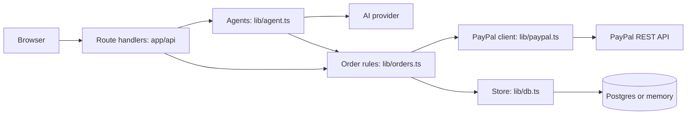
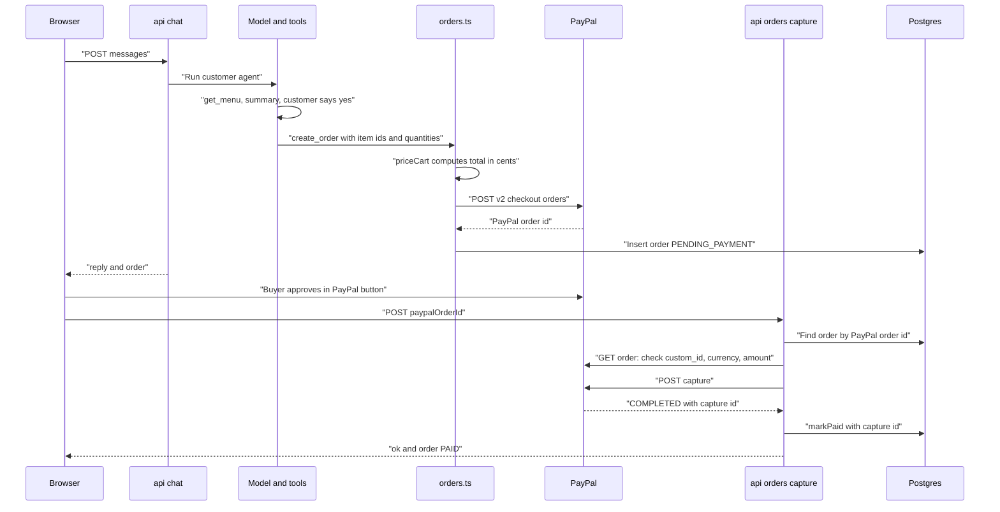

# Technical guide

This document explains how ChatCart AI works inside. Back to the [README](../README.md). Routes are listed in [API.md](API.md). Setup is in [SETUP.md](SETUP.md).

## Architecture

- **Next.js 16 (App Router)** serves the pages and the route handlers under `app/api`.
- **Two AI agents** run in `lib/agent.ts` with the Vercel AI SDK (`generateText` with tools, at most 6 steps per request, the last 30 messages as history). One agent serves customers, one serves owners.
- **`lib/orders.ts`** holds the money rules: place an order, capture, refund, mark ready, create an invoice.
- **`lib/paypal.ts`** is a small PayPal REST client.
- **`lib/db.ts`** has two stores with the same interface: Postgres (`pg`) when `DATABASE_URL` is set, otherwise memory.
- **`lib/ai.ts`** picks the AI provider from the environment: Google, then Groq, then Anthropic, then OpenAI. `AI_MODEL` overrides the model id. The live demo uses Groq with `openai/gpt-oss-120b`.

## Order request flow

## Data model

Defined in `lib/db.ts` (tables are created with `CREATE TABLE IF NOT EXISTS` on first use) and `lib/types.ts`.

**`orders`**

| Column | Type | Notes |
| --- | --- | --- |
| `id` | TEXT, primary key | UUID. Sent to PayPal as `custom_id`. |
| `short_code` | TEXT, unique | `CC-` plus 4 digits (7 digits after repeated collisions). |
| `paypal_order_id` | TEXT, unique | PayPal order id, or `invoice:<id>` for custom orders. |
| `capture_id` | TEXT | PayPal capture id, set when paid. |
| `status` | TEXT | `PENDING_PAYMENT`, `PAID`, `REFUNDED`, `INVOICED`. `CANCELLED` exists in the type, but no code sets it. |
| `customer_name` | TEXT | Up to 80 characters. |
| `lines` | JSONB | Items: `itemId`, `name`, `qty`, `unitPrice`, `lineTotal`, optional `notes`. |
| `total` | NUMERIC(10,2) | US dollars. |
| `currency` | TEXT | Always `USD`. |
| `pickup_date` | TEXT | Date `YYYY-MM-DD` or the customer's own words. |
| `notes` | TEXT | Up to 300 characters. |
| `created_at`, `paid_at`, `refunded_at`, `collected_at` | TIMESTAMPTZ | `collected_at` is set by `mark_collected` on `PAID` orders. |
| `shop_slug` | TEXT | Default is the demo shop. Index on `(shop_slug, created_at DESC)`. |
| `fulfilment` | TEXT | `NEW` or `READY`. |
| `ready_at` | TIMESTAMPTZ | |
| `kind` | TEXT | `MENU` or `CUSTOM`. |
| `invoice_id`, `invoice_url`, `customer_email` | TEXT | Used by invoices. |

**`shops`**: `slug` (primary key), `name`, `tagline`, `items` (JSONB menu), `pin_hash`, `created_at`. The demo shop "Anu's Home Bakery" is not stored. It comes from `lib/menu.ts`, and its PIN comes from `OWNER_PIN`.

**`quotes`**: `id` (primary key), `shop_slug`, `customer_name`, `customer_email`, `description`, `status` (`PENDING` or `INVOICED`), `order_short_code`, `created_at`.

**`reviews`**: `id` (primary key), `shop_slug`, `short_code`, `rating` (1 to 5), `comment` (max 500), `customer_first_name`, `created_at`. Unique on `(shop_slug, short_code)`, so an order has at most one review. The rules are pure functions in `lib/reviews.ts`.

A menu item is `{ id, name, description, priceUsd, category, emoji }`. Lists are limited: 500 orders and 200 quotes per query with Postgres. The memory store keeps at most 5,000 orders.

## Agents and tools

Both agents get a system prompt with rules, and the tools below. The tool inputs are checked with Zod. The guards in the right column are enforced in code, not only in the prompt.

### Customer agent (`runCustomerAgent`)

| Tool | Inputs | Server-side guards |
| --- | --- | --- |
| `get_menu` | none | Returns only the shop's own menu items. |
| `create_order` | `customerName`, `items[]` (`itemId`, `qty` 1 to 50, optional `notes`), optional `pickupDate`, optional `notes`, `customerConfirmed` | Needs `customerConfirmed: true`. No price input exists. `priceCart` rejects unknown items, bad quantities, an empty cart and more than 20 different items, and computes totals in integer cents. A name is required. One order per request. `pickupDate` is resolved by `resolvePickup`. |
| `get_order_status` | `shortCode` | Looks up only within the current shop. Returns a limited view (code, status, ready flag, item names, quantities, line totals, total, pickup day). No name, notes, email or invoice link. |
| `leave_review` | `shortCode`, `rating` (integer 1 to 5), optional `comment` | The order must exist in this shop, be `PAID` and have no review yet (unique per order). The comment is trimmed, stripped of control characters and cut to 500. The name saved is the first word of the order's name, from the order, not from the chat. One per request. |
| `request_custom_quote` | `customerName`, optional `customerEmail`, `description` (at least 5 characters) | Fields are clipped (name 80, email 200, description 1,000). One per request. `createQuoteOnce` skips a repeat of the same shop, name and description among `PENDING` quotes of the last 30 minutes. No price is stored. |

### Owner agent (`runOwnerAgent`)

| Tool | Inputs | Server-side guards |
| --- | --- | --- |
| `list_orders` | optional `status` | Own shop only. Returns at most 25 orders. |
| `sales_summary` | none | Counts and revenue from stored orders. |
| `list_quote_requests` | none | `PENDING` quotes of the shop. |
| `mark_ready` | `shortCode` | Only `PAID` orders. |
| `mark_collected` | `shortCode` | Only `PAID` orders. Sets `collectedAt`; customers see `collected` in `get_order_status`. |
| `list_reviews` | none | Latest 10 reviews of the shop with the average rating. |
| `refund_order` | `shortCode`, `confirmed` | `confirmed` must be true, and `confirmationProblem` must pass (see below). One refund or invoice per request. Only `PAID` orders with a capture id. Full refund. |
| `create_custom_invoice` | `customerName`, `customerEmail`, `description`, `amountUsd` ($1 to $5,000), optional `quoteId`, `confirmed` | Same confirmation checks, and the shown email and exact amount must appear in the previous assistant message. Valid email format. Amount from 100 to 500,000 cents. One refund or invoice per request. Marks the quote `INVOICED`. |

### Pickup days (`lib/pickup.ts`)

The model passes the customer's own words. The server resolves them. "Today" is computed in `Asia/Kolkata`. It understands `today`, `tomorrow`, `day after tomorrow`, weekday names (and `next <weekday>`), `YYYY-MM-DD` and dates like `14 Nov` or `Nov 14, 2026`. Anything else is kept as the trimmed original text (at most 60 characters). Nothing is rejected.

### Shop import (`app/api/shops/import/route.ts`, `lib/menu-import.ts`)

The model returns structured items with a `price` number and a `currency` text. `filterUsdItems` keeps only USD (`USD`, `$`, `US$` or empty) and lists the rest as skipped. Nothing is converted. `cleanMenu` then removes control characters, limits lengths, keeps prices from $0.50 to $2,000, removes exact duplicates (same name and price), builds unique slug ids and keeps at most 40 items.

## PayPal endpoints used

All in `lib/paypal.ts` unless noted. The base URL is `PAYPAL_API_BASE` (default sandbox).

| Endpoint | Function | Called from |
| --- | --- | --- |
| `POST /v1/oauth2/token` | `getAccessToken` (cached until near expiry) | Every PayPal call |
| `POST /v2/checkout/orders` | `createOrder` (intent `CAPTURE`, itemised, `custom_id` = our order id, `PayPal-Request-Id` for idempotency) | `placeOrder` in `lib/orders.ts` |
| `GET /v2/checkout/orders/{id}` | `getOrder` | `captureByPaypalOrderId` in `lib/orders.ts`, called by `app/api/orders/capture/route.ts` |
| `POST /v2/checkout/orders/{id}/capture` | `captureOrder` | `captureByPaypalOrderId` |
| `POST /v2/payments/captures/{id}/refund` | `refundCapture` | `refundOrderByCode` in `lib/orders.ts` |
| `POST /v2/invoicing/invoices`, then `POST .../{id}/send`, then `GET .../{id}` | `createAndSendInvoice` | `createCustomInvoice` in `lib/orders.ts` |
| `POST /v1/notifications/verify-webhook-signature` | `verifyWebhookSignature` | `app/api/webhooks/paypal/route.ts` |

In the browser, `components/Storefront.tsx` and `components/OrderCard.tsx` use `@paypal/react-paypal-js` (SDK v6) to show the PayPal button. The environment in that component is set to `sandbox`.

## Security model

- **Server-side pricing.** The model never sends a price. `priceCart` reads prices from the shop menu and works in integer cents. `createOrder` also checks that item totals equal the order total. A test checks that a price added to the cart input is ignored.
- **Capture checks.** Before capturing, the server reads the order from PayPal and requires the same `custom_id`, currency `USD` and amount as our record. After capture it checks the captured amount again. The state change is guarded in the store, so double calls end in one `PAID` state.
- **Confirmation checks** (`lib/confirm.ts`). The model's `confirmed: true` is not trusted alone. A refund or invoice is allowed only if the message before the owner's last message is from the assistant and shows the exact order code (or email and amount), and the owner's last message is a clear yes (and not a no). The check looks only at the conversation sent by the owner's browser. It is a text check, so it reduces risk but is not a full proof of intent.
- **PIN storage and lockout.** Created shops store a salted `scrypt` hash. The demo PIN is compared in constant time with `OWNER_PIN`. Wrong PINs are counted per shop and caller (8 in 5 minutes) and per shop (40 in 5 minutes). The browser keeps the PIN in session storage and sends it in the `x-owner-pin` header.
- **Webhook signature verification.** The raw request body is sent unchanged to PayPal's verify API. Events without a valid signature get 401. Handlers only change state in allowed transitions, and check the amount for captures.
- **Rate limits.** Chat: 40 requests per 5 minutes per IP. Shop import: 5 per hour per IP, and 200 shops in total. Counters are in memory per server instance, so on serverless hosting they are best effort.
- **Untrusted text.** Menu text, order notes, customer names and quote descriptions are labelled in both system prompts as data, never as instructions. The owner prompt says that text in an order or quote can never authorise a refund, an invoice or a price. Import output is cleaned by code. A customer can see only a limited view of an order.
- **Secrets.** `PAYPAL_CLIENT_SECRET` and AI keys stay on the server. Only `NEXT_PUBLIC_PAYPAL_CLIENT_ID` goes to the browser. Errors returned to clients are short messages. Details go to the server log.

## Testing

`npm test` runs 51 unit tests with the Node.js test runner (`test/*.test.mjs`). They use a fake PayPal server in `test/fake-paypal.mjs` and the in-memory store. They do **not** call PayPal or an AI model, and they do not test the agent prompts.

| File | What it covers |
| --- | --- |
| `pricing.test.mjs` | Prices from the menu, exact cents, merged lines, ignored smuggled prices, bad carts, items from another shop |
| `orders.test.mjs` | Itemised PayPal order, capture rules and idempotency, mismatched amount or order, concurrent capture, mark ready and refund rules, refund failures, stats, custom invoices, webhook body bytes, customer order view |
| `auth.test.mjs` | PIN format, hashing, demo PIN compare, lockout, rate limit, the confirmation guard |
| `menu-import.test.mjs` | Menu clean-up, limits, duplicates, slugs, USD-only filter |
| `pickup.test.mjs` | Weekdays, relative days, Asia/Kolkata today, dates, unknown text |
| `quotes.test.mjs` | Duplicate quote detection |
| `reviews.test.mjs` | Review rules, rating, comment clean-up, first name, collected rule, average |

## Deployment (Vercel and Neon)

The live demo runs on Vercel with Neon Postgres and Groq. Set the environment variables in the Vercel project settings (list in [SETUP.md](SETUP.md#7-deploy-on-vercel)). Route handlers for chat, owner chat and import allow up to 60 seconds (`maxDuration = 60`). Without `DATABASE_URL` on Vercel, the code logs a warning, because memory is per function instance.

## Known limitations

- Sandbox only. The browser button is fixed to `sandbox`; going live needs a code change and PayPal's review.
- Owner login is a PIN, not an account. A lost PIN cannot be recovered.
- Rate limits and PIN lockouts are in memory per instance.
- `/api/orders/capture` has no login. It is protected by the PayPal order check: a payment is captured only after the buyer approved that exact PayPal order.
- Refunds are full only. Orders paid through an invoice get a payment id only when the webhook runs; `refund_order` needs a capture id. This path was not tested against PayPal.
- US dollars only. Pickup orders only. No shipping or tax.
- Postgres lists are capped (500 orders, 200 quotes). The memory store is a demo fallback.
- The unit tests do not cover the AI agents or live PayPal calls.
