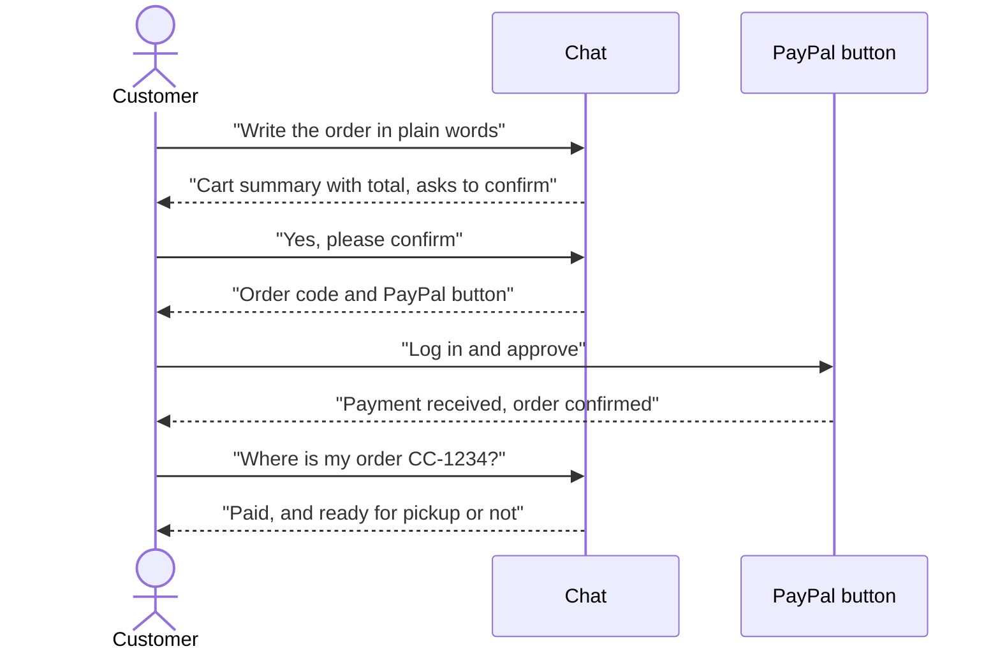
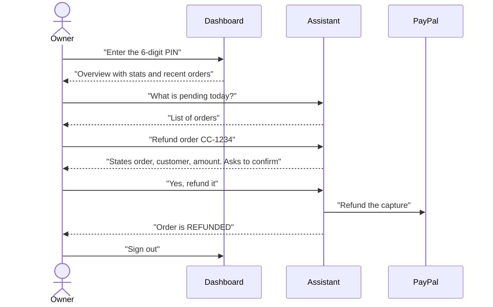
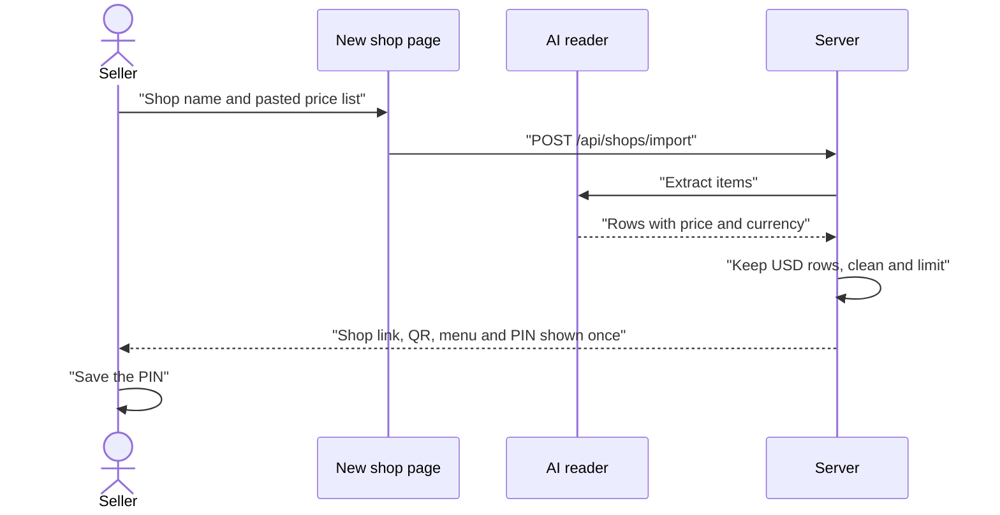

# User guide

This guide shows how to use ChatCart AI. There are three journeys:

1. [Customer](#1-customer): browse, order by chat, pay, check status, ask for a custom item.
2. [Shop owner](#2-shop-owner): sign in, use the dashboard, ask the assistant, refund, invoice, share the shop.
3. [New seller](#3-new-seller): create a shop from a pasted price list.

All payments use the PayPal **sandbox**. No real money moves. Back to the [README](../README.md).

Demo shop: <https://chatcart-ai-alpha.vercel.app> (owner PIN `246810`).

---

## 1. Customer

The demo shop is at `/`. A shop created by a seller is at `/s/<shop-name>`.

### Browse the menu

1. Open the shop page. The menu is on the left (on a phone, below the chat). Each item shows its name, description and price in US dollars.
2. The chat is on the right. It starts with a greeting and three example messages you can tap.

### Order by chat

1. Type your order in normal words. Example: `Hi! I'm Priya. I'd like a chocolate truffle cake and a box of 6 cupcakes for Saturday, no nuts.`
2. The agent matches your words to menu items. It may ask for your name, notes or a pickup day.
3. The agent shows a summary of your cart. The prices come from the server, not from the AI.
4. Read the summary. If it is right, write a clear yes, for example `Yes, please confirm`. If not, say what to change. The agent will show the summary again.

### Confirm and pay

1. After your yes, an order card appears in the chat. It shows an order code such as `CC-1234`, the items and the total.
2. Click the PayPal button. A PayPal window opens.
3. Log in with a PayPal **sandbox buyer** account and approve the payment. In this test setup the buyer account should be a sandbox Personal account in the United States (see [Troubleshooting](#troubleshooting)).
4. The card says "Payment received - order confirmed". Keep the order code. You show it at pickup.
5. If you close the PayPal window, the card says the payment was cancelled. The order is still saved. You can click the button again.

### Check the status of an order

1. In the chat write: `Where is my order CC-1234?`
2. The agent looks up the code and tells you if it is paid and if it is ready for pickup. It does not show names, notes or emails.

### Ask for a custom item

1. Ask for something that is not on the menu. Example: `Can you make a 3 kg wedding cake?`
2. The agent does not give a price. It asks for your name, your email (if you agree) and a clear description.
3. The agent records a custom request for the owner. The owner reviews it and may send you a PayPal invoice by email with a price.
4. If you ask the same thing again in the same way within 30 minutes, no second request is created.
5. A custom order is paid through the PayPal invoice, not through the button in the chat.

---

## 2. Shop owner

The demo dashboard is at `/dashboard`. A created shop has its dashboard at `/dashboard/<shop-name>`.

### Sign in

1. Open `/dashboard` (or `/dashboard/<shop-name>`).
2. Enter the 6-digit owner PIN and click "Unlock dashboard". The demo page shows the demo PIN as a hint.
3. If the PIN is wrong you see a message. After several wrong tries you must wait a few minutes.
4. The PIN is kept in the browser tab only (session storage). It is forgotten when you sign out or close the tab.

### Sidebar sections

On a phone the sidebar opens with the menu button at the top left.

- **Overview.** Four cards: Revenue (from paid orders), Paid, Pending, Refunded. If there are invoiced orders, the Pending card also says how many. Below are the five most recent orders. The page refreshes by itself every few seconds.
- **Orders.** A table of all orders: code, customer, items, total, pickup, status and when it was placed. Statuses: Pending payment, Paid, Refunded, Invoiced. A paid order marked ready shows as ready for pickup.
- **Quote requests.** Custom requests from customers that wait for a price. Each shows name, email (or a note that the email is missing), description and date. A number badge shows how many are waiting. To answer one, use the Assistant.
- **Assistant.** A chat with your assistant. It has example buttons such as "What's pending today?" and "How much did I make?".
- **Share shop.** Your shop link with a Copy button, and a QR code. See below.
- **View storefront.** Opens the customer page of your shop.
- **Sign out.** Forgets the PIN in this tab and returns to the PIN screen.

### Ask the assistant

1. Open **Assistant**.
2. Ask in plain words. Examples: `What's pending today?`, `How much did I make?`, `Show quote requests`.
3. The assistant reads real data with tools. It does not guess numbers or order codes.

### Mark an order ready

1. In the Assistant write: `Mark CC-1234 as ready`.
2. Only paid orders can be marked ready. The customer can then see "ready for pickup" when they ask about the order.

### Refund an order

1. Write: `Refund order CC-1234`.
2. The assistant states the order code, customer and amount, and asks you to confirm.
3. Write a clear yes, for example `Yes, refund it`.
4. The refund is sent to PayPal. The order becomes **Refunded**.
5. Rules: only paid orders with a recorded payment can be refunded, refunds are full, and one refund or invoice is allowed per message. If you do not confirm in a separate message, nothing happens.

### Turn a quote request into a PayPal invoice

1. Open **Quote requests** to read the request.
2. In the Assistant write: `Send an invoice for the custom request` (or name the customer).
3. You choose the price. The assistant never suggests one. If the request has no email, give one.
4. The assistant states the customer name, email, description and amount, and asks you to confirm.
5. Reply with a clear yes. The app creates a PayPal invoice and sends it by email. The amount must be from $1 to $5,000.
6. The request leaves the waiting list. A new order appears with the status **Invoiced**.
7. The order changes to **Paid** automatically only if the optional PayPal webhook is set up (see [SETUP](SETUP.md#5-optional-register-the-webhook)).

### Share the shop link and QR code

1. Open **Share shop**.
2. Click **Copy** to copy the link. Put it in your Instagram or WhatsApp bio.
3. Print or share the QR code. Scanning it opens your storefront.

### Sign out

Click **Sign out** at the bottom of the sidebar.

---

## 3. New seller

Open `/new` (the home page also links to it).

1. Enter a **shop name** (2 to 60 characters).
2. Paste your **menu or price list** exactly as you have it (5 to 8,000 characters). You can click "Try an example" to fill in a sample.
3. Click "Create my shop". It takes a few seconds.
4. The next page shows "<your shop> is live", your shop link and QR code, and your menu as items with prices.
5. **Save your owner PIN now.** It is shown only once. The server stores only a hash, so it cannot show it again.
6. Click "Go to your dashboard" and sign in with the PIN.

Limits:

- **US dollars only.** Prices written in other currencies (for example rupees or euros) are skipped, not converted. If every price is in another currency, the shop is not created and you see a message. Skipped items are not added to the menu.
- **Up to 40 items** per shop. Prices must be from $0.50 to $2,000.
- **5 shops per hour** from one connection (IP address). The server also has a global cap of 200 shops.
- Items with the same name and price are merged into one.

---

## Troubleshooting

**The PayPal window says "Things don't appear to be working at the moment".**
PayPal does not support payments between two Indian accounts, and the sandbox follows the same rule. A default Indian sandbox buyer cannot pay a default Indian sandbox seller. Pay with a sandbox **Personal** account whose country is **United States** (developer dashboard: Sandbox Accounts, Create account, Personal, United States). If that still fails, create a **United States Business** sandbox account, create the app under it, and use that app's Client ID and Secret in the server settings. The exact dashboard labels may differ slightly. See [SETUP](SETUP.md#2-sandbox-accounts-and-the-country-rule).

**If the same error comes back when you click the PayPal button again.** PayPal's window remembers the last sandbox buyer you logged in with, so it retries the same account and fails the same way. Log out at <https://sandbox.paypal.com> (or open the site in a private/incognito window), place a **new** order in the chat, and log in with the United States sandbox buyer. If the window opens already logged in as the wrong account, use the "Not you?" or "Change" link near the name to switch.

**A "Setup needed" banner is shown.**
The server has no PayPal keys, or no AI key, or both. The banner says which one is missing. The owner of the deployment must set the variables listed in [SETUP](SETUP.md). Open `/api/health` to see what is configured.

**I forgot my owner PIN.**
It cannot be recovered. Only a hash is stored, and there are no accounts or reset emails. Create a new shop at `/new`.

**"Too many wrong PIN attempts".**
Wait a few minutes and try again.

**The assistant or agent does not answer, or says it is busy.**
Free AI plans have rate limits. Wait a minute and try again. If it keeps happening, the deployment owner can switch to another provider or model (see `AI_MODEL` in [SETUP](SETUP.md)). The chat also limits a visitor to 40 messages in 5 minutes.

**My order disappeared.**
If the server has no `DATABASE_URL`, data is kept in memory and is lost on restart.

**An invoice order stays "Invoiced" after the customer paid.**
The status updates only when the optional webhook is set up.
